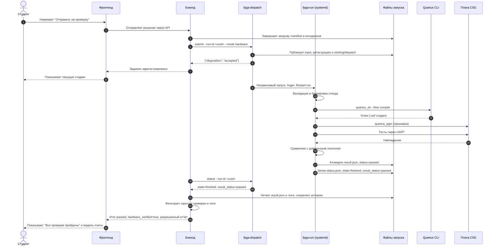
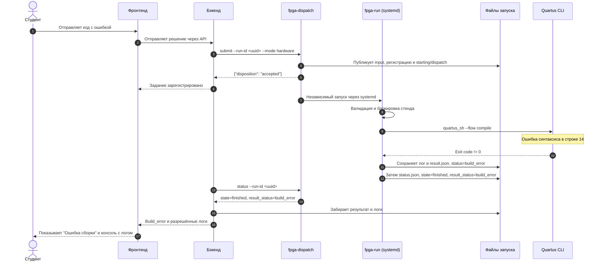
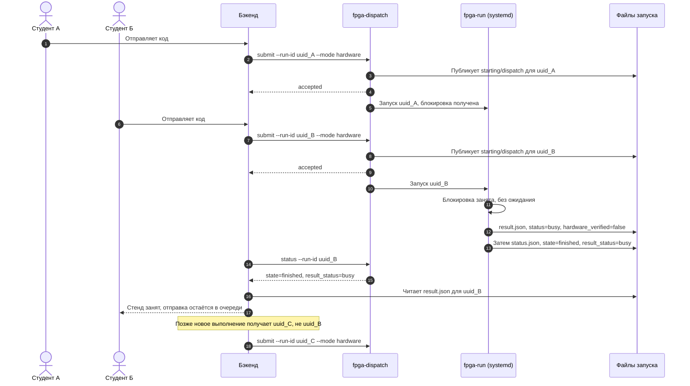
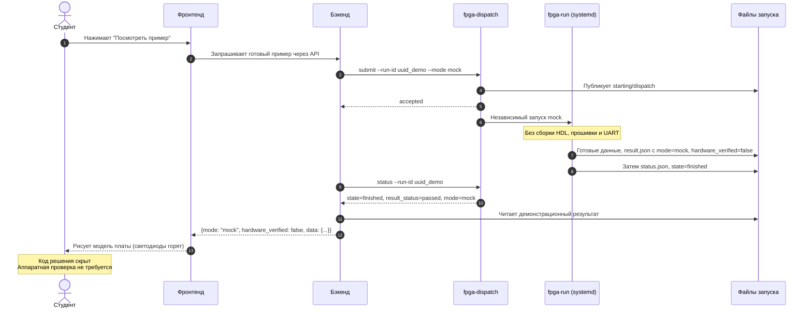
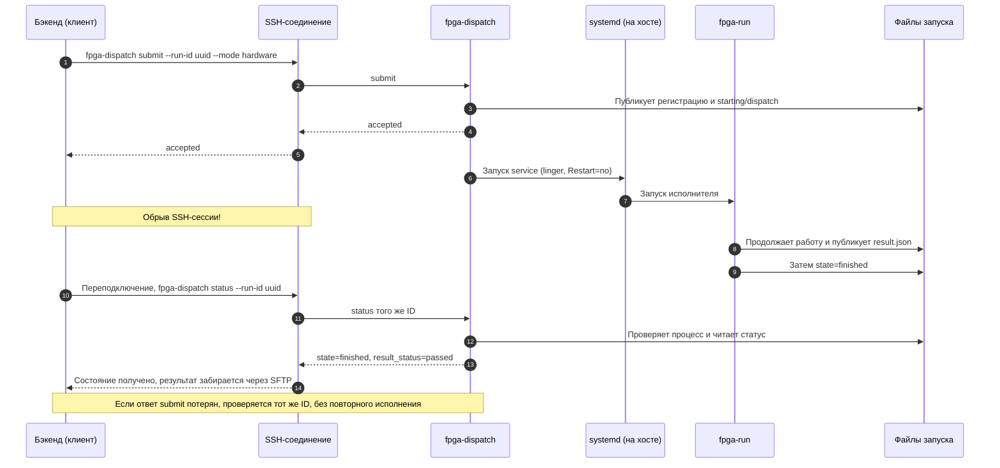
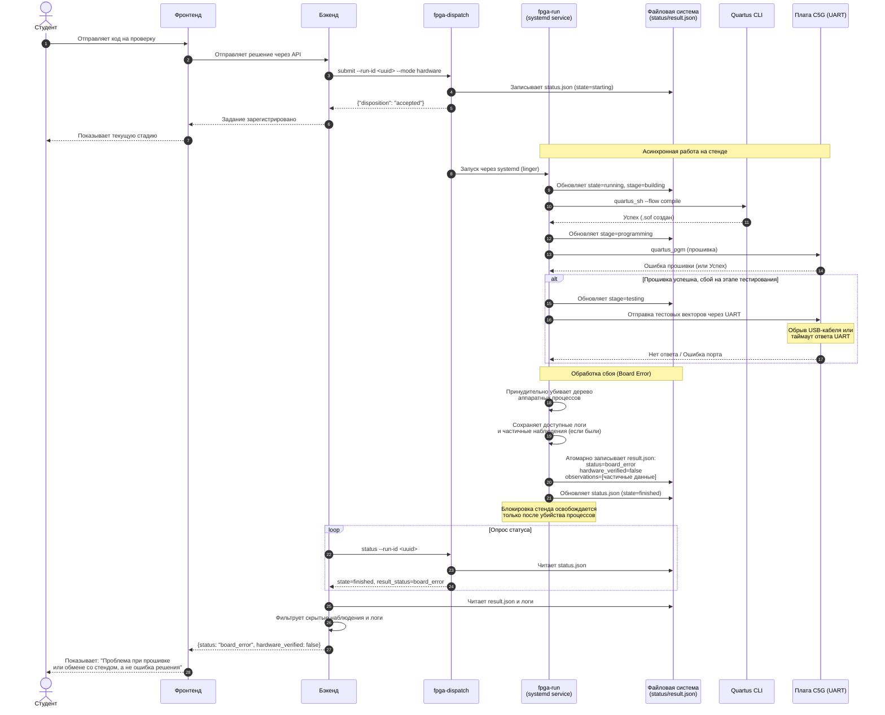
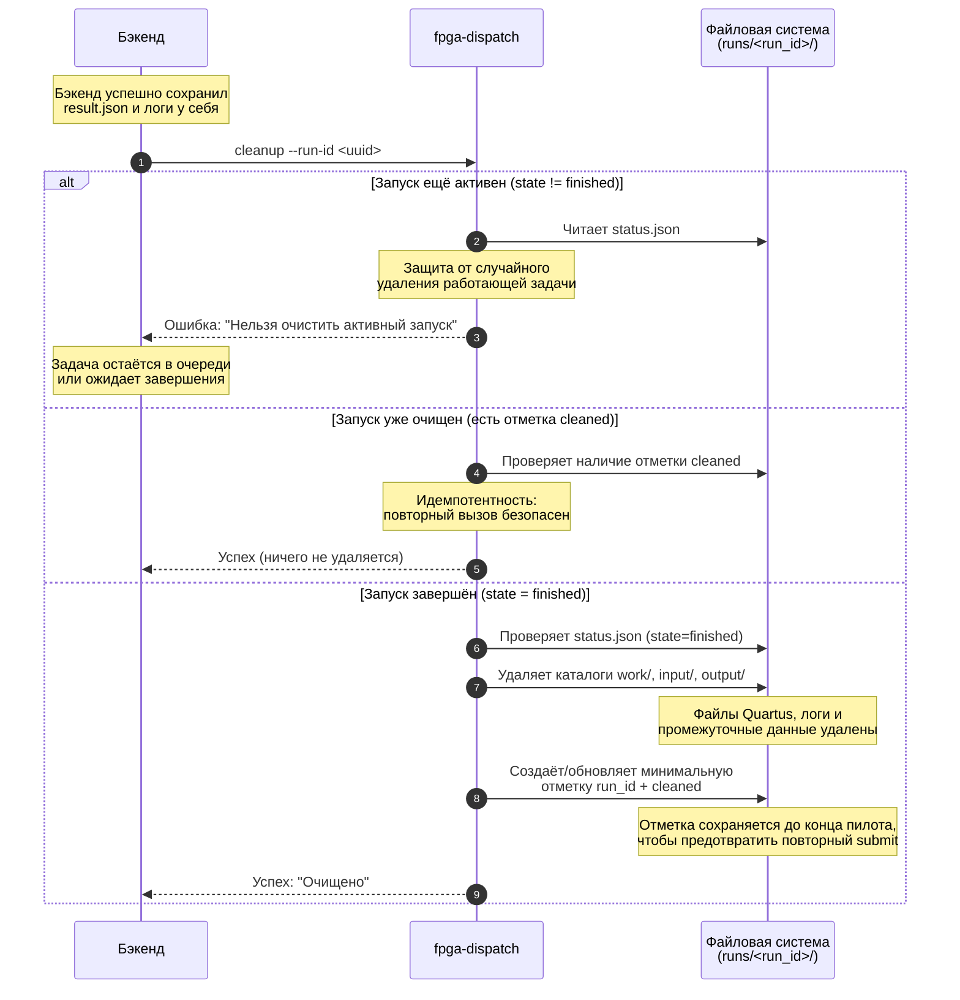
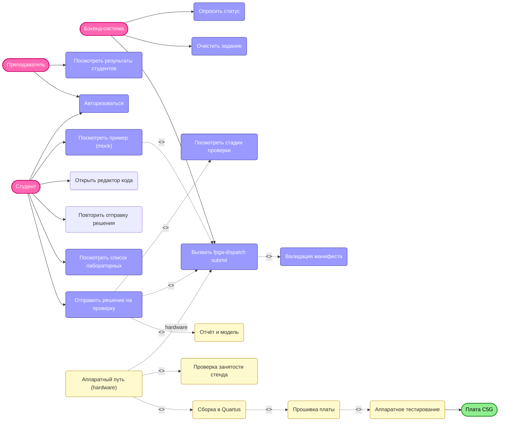

# Диаграммы последовательности (Sequence Diagrams)
Этот документ описывает ключевые сценарии взаимодействия между Фронтендом, Бэкендом, Диспетчером (fpga-dispatch) и платой C5G.

Диаграммы показывают целевое поведение по [контракту](contract.md),
а не готовность реализации. API сайта и способ доставки прогресса выбираются
отдельно. Перед submit бэкенд завершает загрузку manifest и исходников;
при разных хостах файлы передаются через SFTP, команды — через SSH.
В браузер попадают только разрешённые данные, без скрытых векторов и эталонов.
Обозначения uuid_A, uuid_B, uuid_C и uuid_demo представляют разные UUID.

---

## 1. Успешная отправка и проверка кода
*Описание: Студент отправляет верный код, система собирает его, прошивает плату и возвращает успешный результат.*

---
## 2. Ошибка сборки
*Описание: Код не собирается. Исполнитель сохраняет лог и возвращает build_error без прошивки платы.*

---
## 3. Стенд занят
*Описание: Плата уже выполняет задачу другого студента. Система не ставит в очередь на уровне железа, а возвращает статус busy.*

---
## 4. Mock: Просмотр примера
*Описание: Студент смотрит, как работает правильное решение. Физическая плата не задействуется.*

---

## 5. Обрыв связи и восстановление
*Описание: SSH-сессия обрывается во время сборки. Благодаря systemd задача продолжается в фоне.*

---

## 6. Сбой прошивки или обмена со стендом (Board Error)
*Описание: Сборка прошла успешно, но на этапе прошивки или тестирования по UART произошёл сбой. Система корректно завершает процесс, сохраняет частичные данные и возвращает понятную ошибку.*

---

## 7.Очистка завершённого задания (Cleanup)
*Описание: Бэкенд сохранил результат и логи у себя и запрашивает очистку временных файлов на стенде, чтобы освободить место для новых задач. Система гарантирует, что активные задачи не будут удалены, а повторный вызов безопасен.*

---

# Диаграмма вариантов использования

