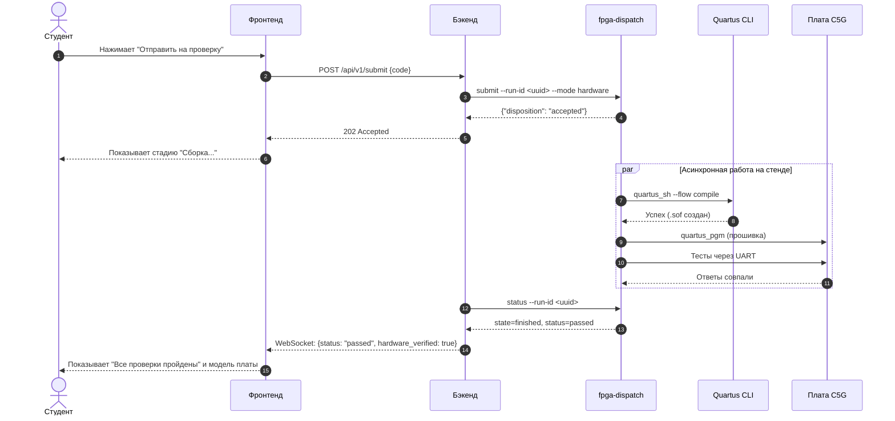
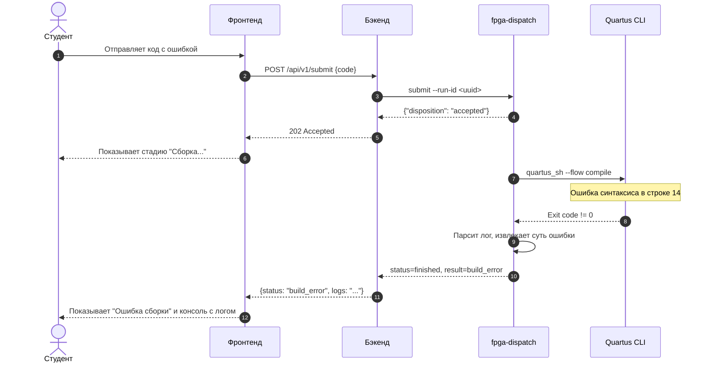
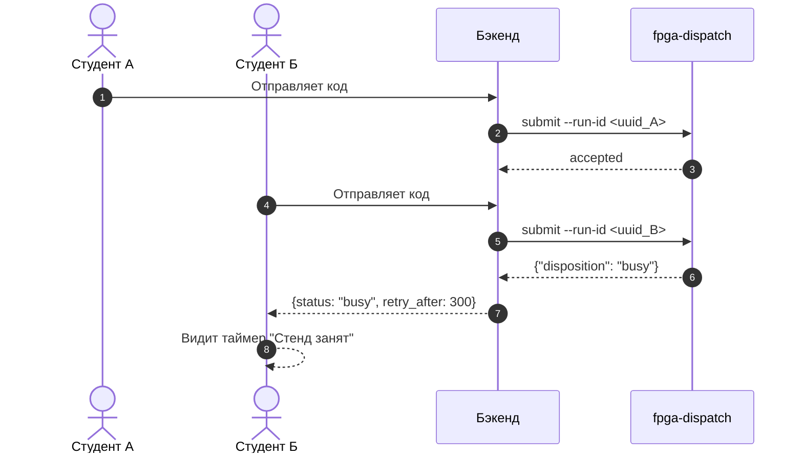
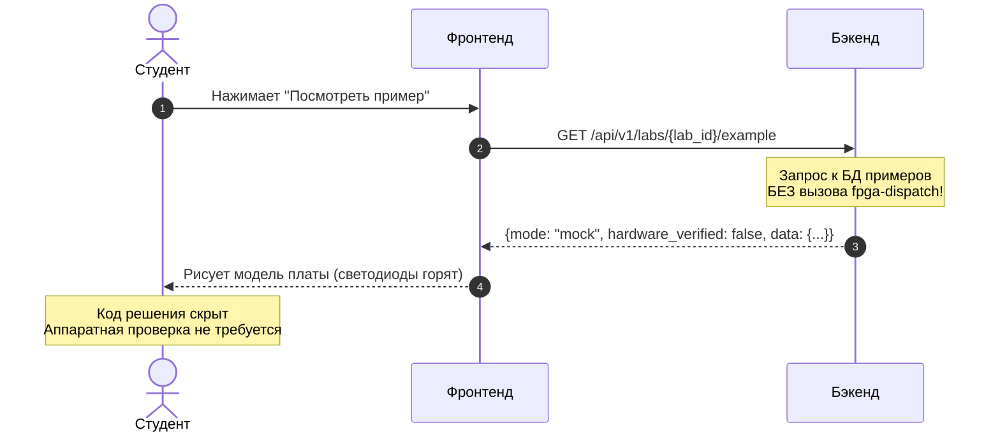
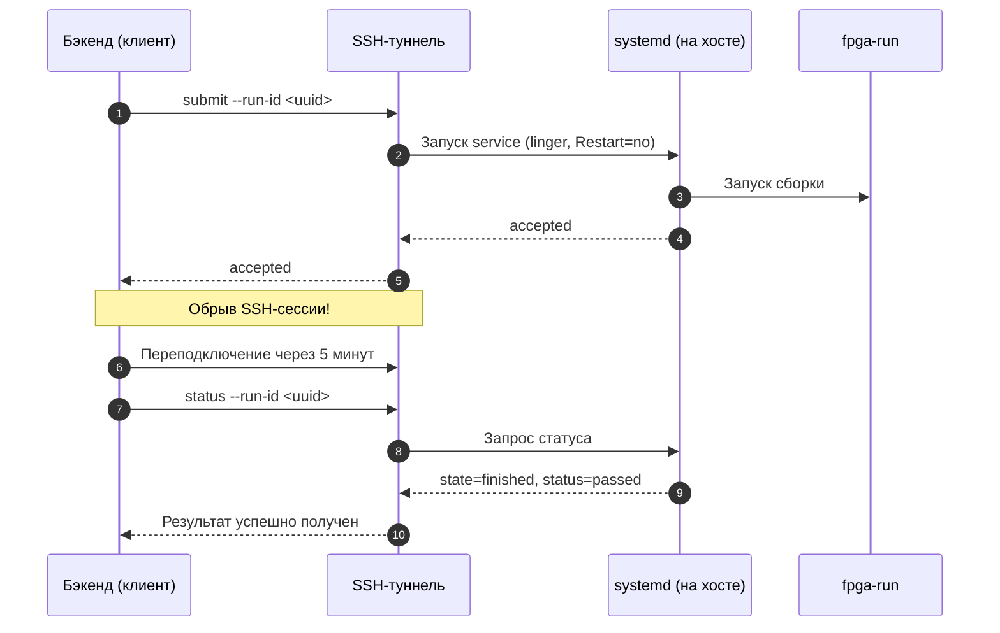
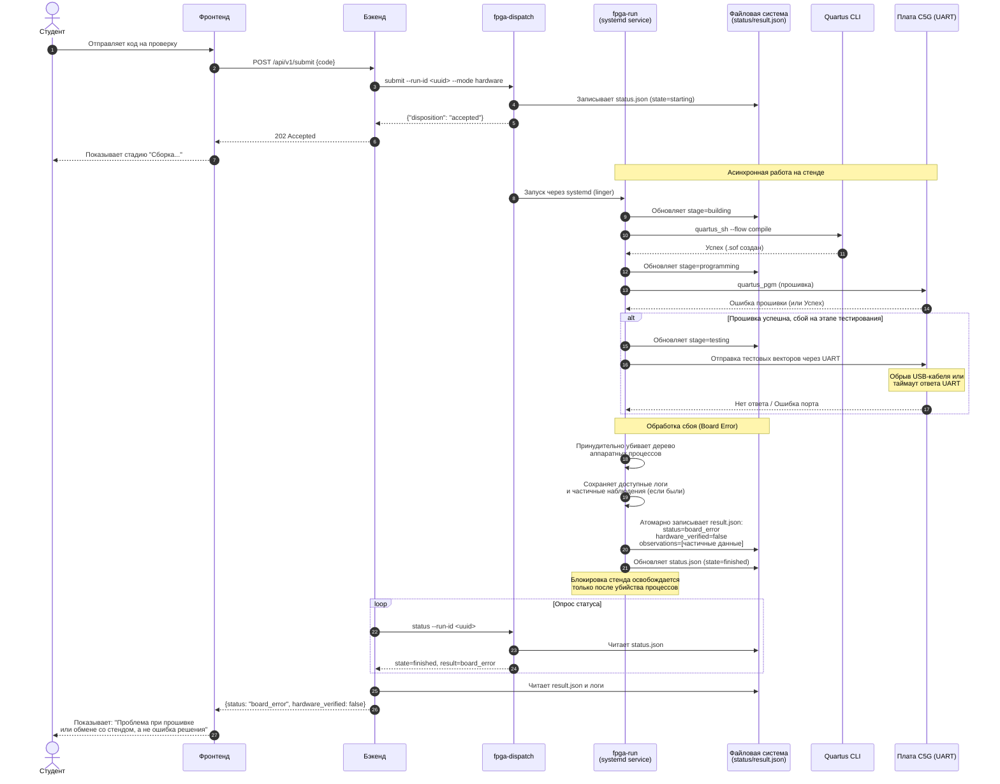
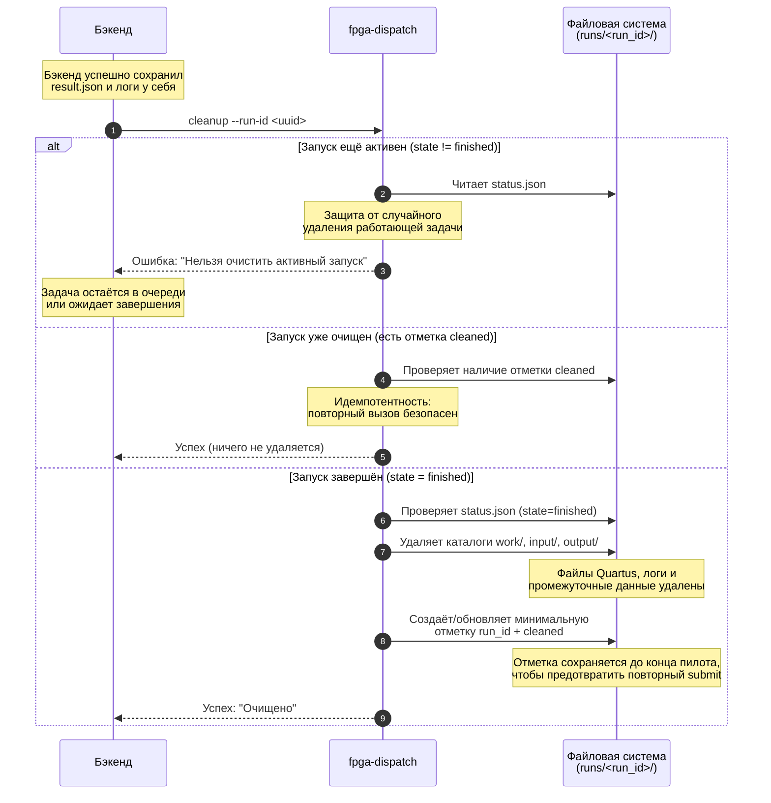
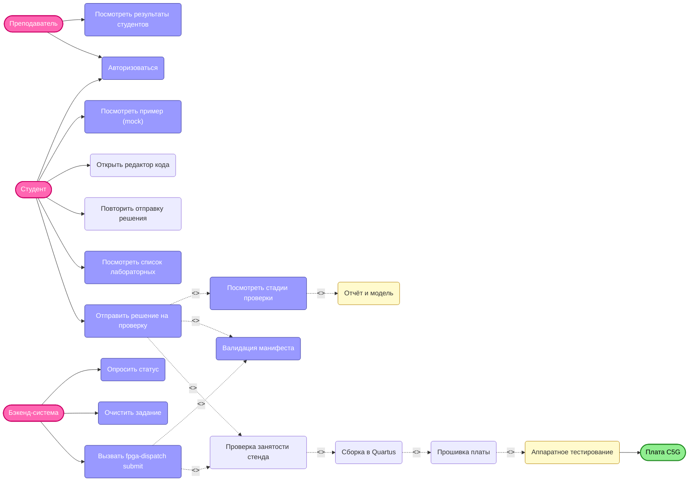

# Диаграммы последовательности (Sequence Diagrams)
Этот документ описывает ключевые сценарии взаимодействия между Фронтендом, Бэкендом, Диспетчером (fpga-dispatch) и платой C5G.

---

## 1. Успешная отправка и проверка кода
*Описание: Студент отправляет верный код, система собирает его, прошивает плату и возвращает успешный результат.*

---
## 2. Ошибка сборки
*Описание: Студент отправляет верный код, система собирает его, прошивает плату и возвращает успешный результат.*

---
## 3. Стенд занят
*Описание: Плата уже выполняет задачу другого студента. Система не ставит в очередь на уровне железа, а возвращает статус busy.*

---
## 4. Mock: Просмотр примера
*Описание: Студент смотрит, как работает правильное решение. Физическая плата не задействуется.*

---

## 5. Обрыв связи и восстановление
*Описание: SSH-сессия обрывается во время сборки. Благодаря systemd задача продолжается в фоне.*

---

## 6. Сбой прошивки или обмена со стендом (Board Error)
*Описание: Сборка прошла успешно, но на этапе прошивки или тестирования по UART произошёл сбой. Система корректно завершает процесс, сохраняет частичные данные и возвращает понятную ошибку.*

---

## 7.Очистка завершённого задания (Cleanup)
*Описание: Бэкенд сохранил результат и логи у себя и запрашивает очистку временных файлов на стенде, чтобы освободить место для новых задач. Система гарантирует, что активные задачи не будут удалены, а повторный вызов безопасен.*

---

# Use Case Diagram: Платформа удалённых лабораторных

# Диаграмма вариантов использования

